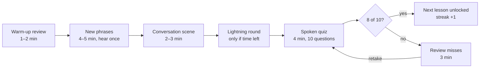

# Spanish Voice Coach — Requirements

Nov 8, 2026 · Satya Rami

> Mirror of the requirements doc kept in Claude: https://claude.ai/artifact/1s5VancZDfom1NWxkTDBRD
> Every requirements change is pushed here automatically.

## Goal and learner

The goal: after 6 months, hold a beginner to advanced-beginner conversation with native speakers and get your thoughts and ideas across, through 15 minutes a day of spoken practice only.

- **Learner:** fluent English, already multilingual, close to zero Spanish. Comfortable with a phone, wants fun rather than drills.
- **Time budget:** 15 minutes a day (changed from 30), about 180 sessions and 45 hours in total. Spaced review carries more of the load, so the goal may take somewhat longer.
- **What success looks like:** talking with native speakers about introductions, ordering food, directions, shopping, travel, making plans, telling what happened yesterday, giving opinions, and keeping a conversation going with fillers and follow-up questions. Getting your meaning across matters more than perfect grammar, including rephrasing when you don't know a word. Roughly CEFR A2.
- **Spanish variety:** Latin American (Mexican) Spanish (confirmed).

## Daily session (15 min) and quiz gate

Every session is 15 minutes: about 11 minutes of spoken learning, then a spoken quiz of about 4 minutes. Each phrase is practised once in the lesson, with no extra repetition. You must pass the quiz to unlock the next lesson.

| Part | Minutes | What happens |
| --- | --- | --- |
| Warm-up review | 1–2 | Up to 4 phrases from earlier lessons, on a spaced-repetition schedule. You hear English and say the Spanish. |
| New material | 4–5 | 6 to 8 new phrases. You hear each one once and repeat it once. It is replayed only if you miss. |
| Conversation scene | 2–3 | A role-play, such as ordering at a café. The app plays the other person and you answer aloud, once. Help comes only when you miss. |
| Lightning round | 0–2 | A fast mix of today's and earlier phrases, only if time is left before minute 11. |
| Quiz | 4 | 10 spoken questions: 6 from today and 4 from review. You hear English and say the Spanish, with one attempt per question. |

A failed quiz loops through a short review of the missed phrases and a fresh quiz, until you pass.

**Gate rules**

- Passing means 8 of 10 correct (80%). A pass unlocks the next lesson and adds to your streak.
- If you fail, a 3-minute review drills only the phrases you missed. Then you take a fresh, reshuffled quiz. Retries are unlimited, and the quiz can't be skipped.
- After each quiz answer, the app says the correct Spanish so the quiz also teaches.
- The timer counts only active time. Pausing stops the clock.
- **Rewind and fast forward:** ⏪ 30s and 30s ⏩ buttons during a session jump back or ahead by about 30 seconds of teaching. Rewind uses the actual time each step started. Neither works inside the quiz. Fast forward during the lightning round goes straight to the quiz.
- **Lessons menu:** the home screen lists every session. Passed lessons (✓) can be replayed as practice; this never changes your current place, and passing again doesn't skip you ahead. The current lesson (▶) continues exactly where you left off. Lessons whose quiz you haven't passed are locked (🔒) and can't be opened.

## Voice-only interaction

All teaching happens by speech. There is no typing anywhere, and taps are limited to Start, Pause and Settings.

- **The app speaks** every instruction in English and every Spanish model phrase. Slow and normal speeds are available.
- **You answer aloud.** The app starts listening automatically after each prompt, so it works hands-free. If the iPhone blocks its built-in speech service, the app switches by itself to on-device listening (Whisper). That needs a one-time download of about 75 MB, stays hands-free, and detects when you start and stop talking.
- **Scoring is forgiving on accent but checks the words.** A near miss gets "Almost, listen again". The app replays the phrase and you retry.
- **Voice commands:** say "repite" or "otra vez" to replay, "no sé" to hear the answer, and "pausa" to pause.
- **Very little reading:** the screen shows a large speaking or listening indicator. Spanish text appears only after you answer, as a memory aid. An "Ears only" setting hides all text.

## Voices

You pick a female or male voice, and each voice has a preview button before you commit.

- **Spanish teacher voice:** female or male. The list shows every Spanish voice on your iPhone, labelled female or male, and plays "Hola, ¿cómo estás?" as a preview.
- **English instruction voice:** chosen separately, also female or male.
- **Conversation scenes** use a second voice of the other gender for the other characters, so dialogues sound like two real people.
- **Pleasant sound:** the app prefers the iPhone's "Enhanced" and "Premium" voices, which are much more natural than the defaults. They are a free download in the iPhone's Accessibility settings under Spoken Content → Voices. The voice must sound natural, not monotone or robotic. If only the basic voices are installed, the home screen shows how to download the better ones.
- **Speed:** a slow, normal or fast slider applies to all Spanish speech.

## Your name

The coach asks your name once and uses it from then on.

- **Asked once:** at the start of the first session, the coach asks "What's your name?". You say it, or type it if the listener gets it wrong. It is saved on the phone with your progress and never asked again.
- **Pronunciation check:** the coach says "¡Hola, <name>!" in the Spanish voice and asks whether that sounded right. Say or tap yes or no. If no, you type your name the way it sounds (for example "Sah-tee-ah") and it tries again, until you say yes. The written name stays as you spelled it; the sounds-like spelling is used only for speech.
- **Every cheer uses your name:** "¡Muy bien, Satya!", "¡Cinco seguidas! ¡Increíble, Satya!", "¡Felicidades, Satya!", and the lesson greeting "¡Hola, Satya!".
- **Change it any time:** Settings → Your name → Change runs the same ask-and-check again.
- **Each person their own:** the name is stored per phone, so each family member using the link gets their own name and progress.

## Curriculum and 6-month plan

The 6 months are split into four phases of about 6 weeks each. Every sixth session is a review-and-conversation day with no new material.

| Phase | Weeks | You learn to |
| --- | --- | --- |
| 1. Survival | 1–6 | greet people, introduce yourself, be polite, use numbers and prices, order in a café, ask directions, say what you want, have and like |
| 2. Everyday life | 7–12 | tell the time, make plans with "voy a…", order in restaurants, shop, describe feelings with "estar", talk about the weather, handle hotels and travel, talk about work and hobbies |
| 3. Telling stories | 13–19 | describe the past (yesterday and "when I was young"), daily routines, comparisons and opinions, and use fillers that keep a conversation flowing |
| 4. Real conversation | 20–26 | handle longer and freer role-plays, wishes and hopes ("espero que…", "me gustaría…"), and simple hypotheticals, with a weekly 10-minute "boss conversation" |

- **Built for a multilingual learner:** it uses cognates and patterns you already know, and gives short spoken tips on sounds and grammar, without long explanations.
- **Scenes come from your life:** golf, tennis, bridge, travel, meditation and family.
- **Delivery:** the first release covers Phase 1 and the start of Phase 2, about 36 sessions. Later phases arrive as updates at the same link, before you reach them.

## Fun and motivation

The app should feel like a game with a story, not a drill.

- **A running story:** the lessons follow a trip from Mexico City to Oaxaca and on to the coast. Each scene is a new place with new characters.
- **A coach character:** Lola, a warm and playful host who cheers in Spanish ("¡Eso es!", "¡Qué bien!").
- **Points and combos:** each correct answer earns points. Correct answers in a row build a combo with rising chime sounds. Every correct answer gets spoken praise that includes your name, with varied cheers and bigger celebrations at 3, 5 and 10 in a row. Misses get kind wording ("Good try", "Casi").
- **Daily streak:** a pass extends your streak, which shows on the home screen.
- **Levels:** Turista → Viajero → Conversador → Experto, each with a short celebration.
- **Sounds:** a short fanfare when you pass a quiz, and soft chimes for right answers. There are no harsh buzzers.

## Progress saving and resume

Progress is saved after every answer, and you can continue exactly where you left off, even in the middle of a session.

- **What is saved:** your name and how to say it, the current lesson, the session part and question you were on, the time already spent, your quiz history, spaced-repetition data for every phrase, points, streak and settings.
- **Resume:** if you close the app mid-session, the home screen offers "Continue session (14 min done)" or "Restart this lesson".
- **Where it is stored:** on your iPhone, inside the app. All versions of the app share the same progress, so updating or rolling back loses nothing. New features never send an existing user back to lesson 1: your place is stored by lesson name rather than number, so adding lessons can't move you, and the app keeps a copy of your progress before each update. If saved data can't be read, the app restores the copy rather than starting over.
- **Safety:** use the app from its Home Screen icon. Plain Safari can clear data from websites you haven't opened for several days. A "Back up progress" button saves a backup file through the iPhone share sheet, for example to Files or Notes, and "Restore" reads it back.

## Platform, link, versions and rollback

The app is an iPhone web app hosted on GitHub Pages at one permanent link. Every version is kept, and you can roll back at any time.

- **On the iPhone:** open the link in Safari, then choose Share → Add to Home Screen. It gets its own icon and opens like an app. Safari provides the speaking and the listening it needs.
- **Why not inside Claude:** the Claude artifact viewer blocks the microphone, so hands-free listening can't work there.
- **Permanent link:** https://satyarami.github.io/spanish-coach/. It always serves the current version.
- **Versions:** each release is numbered (v1, v2, …) and listed on a "What's new" screen. The previous version stays live at the same link plus `/previous/`, and Settings has a button to switch to it.
- **Rollback:** tell me "roll back" and the previous version becomes current again. Git keeps every older version, so any of them can be restored.
- **Seeing it first:** each new version shows its "What's new" summary on first open, and you can try the previous version side by side. New builds go to a separate preview link first. Nothing reaches the main branch or the permanent link until you've tried it and approved it.
- **One-time setup:** done. GitHub is connected and the repository is satyarami/spanish-coach.

## Feedback loop

You can give feedback at any moment by voice. The app collects it and sends it to me, and the next version addresses it.

1. **Speak feedback anytime:** tap the feedback button or say "comentario". You speak in English, or type or use keyboard dictation, and the app saves the note with the lesson, phrase and time.
2. **Automatic notes:** the app also logs phrases you keep missing, words the listener keeps mishearing, and sessions that ran long or short.
3. **Send it:** "Send feedback" opens a pre-filled GitHub page with everything collected, and one tap on Submit sends it. An automation saves it in the repository's feedback folder as feedback/01.md to feedback/10.md. Only the latest 10 are kept: the 11th replaces the oldest, and so on. Everyone's feedback is handled the same way, and senders need a GitHub account. The share sheet remains as a backup.
4. **I improve the app:** I publish a new version at the same link, list your items in "What's new", and keep the previous version available for rollback.
5. **This doc is the source of truth.** Edit it or comment here whenever your requirements change, and I build to the current text. It is mirrored to REQUIREMENTS.md in the GitHub repository, and every requirements change is pushed there automatically.

## Open questions for you

Answer these by editing inline or with a comment. The defaults in brackets are what I'll build if you don't change them.

- [ ] Latin American Spanish or Spain? Decided: Latin American.
- [ ] Limit of one new lesson per day, or allow more after a pass? [More allowed]
- [ ] Pass mark of 8 out of 10? Decided: yes, 8 of 10.
- [ ] After a failed quiz, retake right away or next day? [Right away, after the 3-minute review]
- [ ] Show the Spanish text after you answer, or ears only by default? [Show after answering]
- [ ] Any other interests to build scenes around, beyond golf, tennis, bridge, travel, meditation and family?
- [ ] GitHub account? Decided: satyarami, repository spanish-coach.
